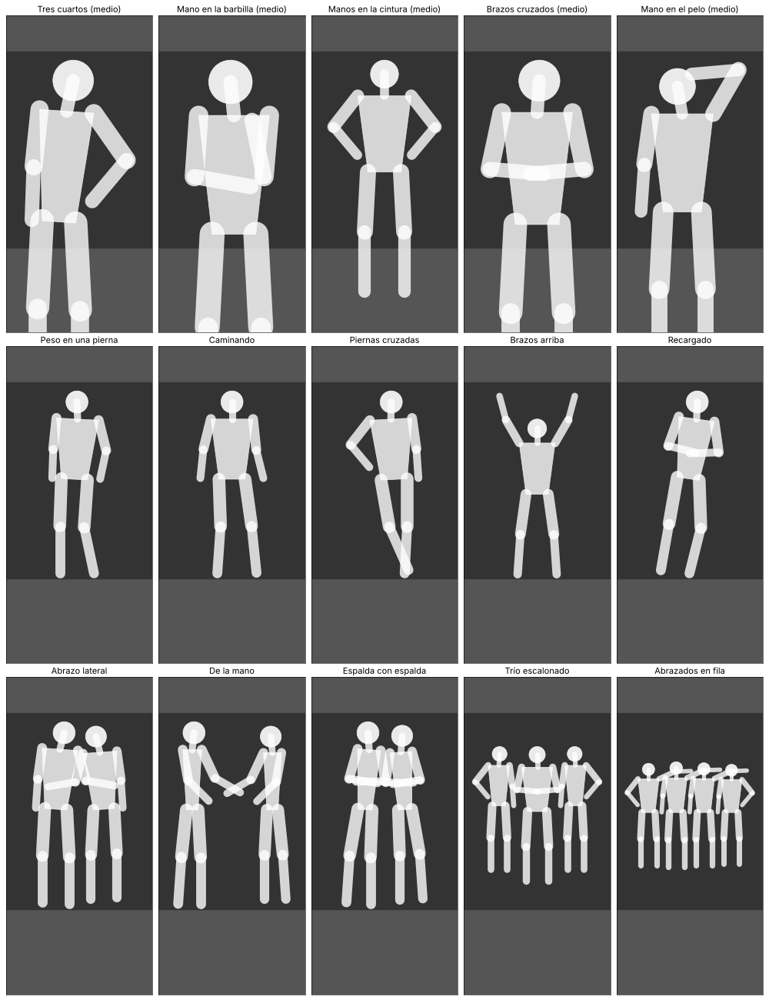

# Posa — cámara con guía para posar

App de Android (Kotlin + Jetpack Compose) que muestra una **silueta de la pose** sobre la cámara y, con **ML Kit Pose Detection**, compara en tiempo real tu postura con la silueta: colorea cada parte del cuerpo (verde = bien, naranja = casi, rojo = corregir) y te da indicaciones como *"Sube la mano derecha"* o *"Acércate a la cámara"*.



## Funciones

- **15 poses** en 4 categorías: Retrato (medio cuerpo), Moda (cuerpo completo), Pareja y Grupo.
- **Silueta guía** con contorno que se pone verde cuando coincides.
- **Esqueleto en vivo** coloreado por parte del cuerpo y **puntuación 0–100**.
- **Indicaciones en español** que usan el lado real de la persona (funciona igual con cámara frontal o trasera).
- **Modo Auto**: toma la foto sola cuando sostienes la pose ~1 segundo.
- **Temporizador** de 3 o 10 segundos (ideal para grupos).
- Consejos de cada pose, cambio de cámara, miniatura de la última foto.
- Las fotos se guardan en **Imágenes/Posa**. Todo se procesa en el teléfono.

> La detección de ML Kit sigue a **una sola persona**. En poses de pareja y grupo la silueta funciona como guía visual (sin puntuación).

## Cómo compilar

1. Instala **Android Studio** (versión reciente) con el SDK de Android 36.
2. *File › Open* y elige la carpeta `Posa`.
3. Espera la sincronización de Gradle (descarga AGP 8.13, Kotlin 2.2, CameraX 1.5 y ML Kit).
4. Conecta tu teléfono con la depuración USB activada y pulsa **Run ▶**.

Desde terminal: `./gradlew assembleDebug` → el APK queda en `app/build/outputs/apk/debug/`.

Requisitos: Android 6.0 (API 23) o superior, JDK 17.

## Estructura

```
app/src/main/java/com/posa/app/
├── MainActivity.kt          Punto de entrada
├── camera/
│   ├── PoseCamera.kt        CameraX + ML Kit (coordenadas ya mapeadas a la vista previa)
│   └── PhotoUtils.kt        Miniaturas y abrir la galería
├── pose/                    Lógica pura (sin Android, con pruebas unitarias)
│   ├── Skeleton.kt          Figura por ángulos → esqueleto; encuadre en pantalla
│   ├── PoseLibrary.kt       Las poses
│   └── PoseMatcher.kt       Comparación, puntuación e indicaciones
└── ui/
    ├── PosaApp.kt           Permisos
    ├── CameraScreen.kt      Pantalla principal
    ├── SilhouetteDrawing.kt Dibujo de silueta y esqueleto
    └── Theme.kt
```

## Agregar una pose

Cada figura se define con ángulos en grados (0 = abajo, 90 = derecha de la pantalla, 180 = arriba). Copia una pose en `PoseLibrary.kt` y ajusta:

```kotlin
PoseTemplate(
    id = "mi_pose",
    name = "Mi pose",
    category = PoseCategory.FASHION,
    framing = Framing.FULL_BODY,
    figures = listOf(
        FigureSpec(
            torso = 178f,                  // inclinación del pecho
            leftArm = Limb(-38f, 40f),     // brazo, antebrazo (lado izquierdo de la pantalla)
            rightArm = Limb(150f, 275f),
            leftLeg = Limb(-2f, 0f),       // muslo, pantorrilla
            rightLeg = Limb(-4f, 12f),
        )
    ),
    tips = listOf("Consejo 1", "Consejo 2"),
)
```

Las pruebas en `app/src/test` verifican que cada pose individual coincide consigo misma con ambas cámaras (`./gradlew test`).
